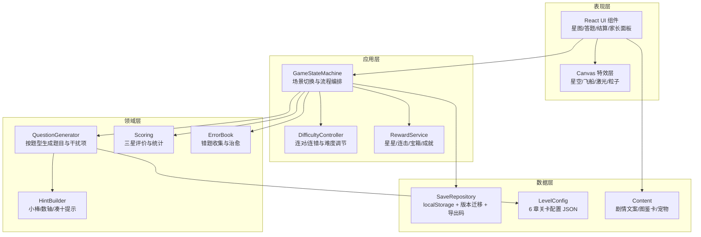

# 《星际数学小勇士》开发计划书

> 角色视角：软件架构师 / 技术负责人  
> 版本：v1.0　日期：2026-11-23  
> 上游文档：[星际数学小勇士_游戏策划案.md](./星际数学小勇士_游戏策划案.md)  
> 本文目的：把策划案变成**可执行、可验收、可排期**的工程方案，覆盖技术选型、架构、分步任务、测试、风险与发布。

---

## 0. 阅读指南

- 如果你是**开发者**：重点看第 3、4、5、6、7、8、9 章。
- 如果你是**家长 / 项目发起人**：重点看第 1、2、7、10、11 章。
- 第 2 章列出了所有「条件与假设」，如有不符请先修正再排期。
- 第 8 章是逐任务 WBS，可直接拆成 issue / 待办清单。

---

## 1. 项目目标与范围

### 1.1 一句话目标

交付一个**免安装、离线可玩、手机/平板/电脑浏览器均可用**的 Web 游戏，完整实现策划案中的 6 章主线、题目生成、星星/宠物收集、错题本与家长面板。

### 1.2 本期范围（In Scope）

| 范围 | 内容 |
| --- | --- |
| 玩法 | 6 章主线关卡 + 每章 Boss 关、三星评价、剧情对话 |
| 学习 | 题目生成器、三级提示、自适应难度、错题本与重练 |
| 激励 | 星星、连击、图鉴卡、外星宠物、宝箱、成就勋章、每日任务 |
| 家长 | 学习报告、时长限制、自定义题单、难度锁定 |
| 技术 | 本地存档、离线可用（PWA）、音效与中文语音朗读 |

### 1.3 非目标（Out of Scope，明确不做）

- ❌ 后端服务、账号注册、云同步（v1 纯本地）。
- ❌ 广告、内购、数据分析 SDK（儿童产品红线）。
- ❌ 联网排行榜、多人 PK（放到未来版本）。
- ❌ 乘除法、100 以上运算（超纲）。
- ❌ 原生 App 打包（Web 优先，后续可加）。

### 1.4 可量化成功标准

| 指标 | 目标值 | 验证方式 |
| --- | --- | --- |
| 功能完整度 | 策划案 P0 功能 100% 实现，P1 功能 ≥ 80% | 验收清单逐项打勾 |
| 题目正确性 | 生成题目 100% 满足：结果 ∈ [0,100]、符合章节知识点、答案唯一 | 自动生成 1000 题/类型的断言测试 |
| 设备兼容 | iPad Safari、Android Chrome、微信内置浏览器、桌面 Chrome 均可正常通关 | 真机测试矩阵 |
| 儿童可用性 | 目标儿童可**独立**完成一关，无需大人读题；试玩中无哭闹/卡死 | 真实儿童 15–20 分钟观察 |
| 性能 | 中端手机首屏可交互 < 3 秒；答题切换无卡顿（> 30 FPS） | 真机计时 + 浏览器 Performance 面板 |
| 离线 | 首次加载后断网仍可完整游玩 | 断网测试 |

---

## 2. 约束条件与假设（"各种条件"）

> 这一章是排期的前提。任何一条不成立，都需要回到本章重估方案与工期。

| 类别 | 条件 / 约束 | 对方案的影响 | 应对 |
| --- | --- | --- | --- |
| **用户** | 7–8 岁，识字量有限，精细动作仍在发展 | 必须有语音朗读；按钮 ≥ 44px；输入以点选为主 | 数字键盘 + 4 选 1；SpeechSynthesis 朗读题干 |
| **设备** | **主力为电脑浏览器（已确认）**；平板/手机为辅 | 桌面鼠标优先，仍保留触控兼容 | 以 16:9 桌面大屏为主布局，按钮 ≥ 44px；保留响应式兜底 |
| **浏览器** | 中国家庭高频使用**微信内置浏览器**（iOS/Android） | 该环境对 localStorage、音频自动播放有限制 | 音频需用户手势解锁；存档异常时降级为内存存档并提示 |
| **网络** | **必须支持离线（已确认，车上/老家/无网环境）** | PWA 为必选项；不能依赖 CDN / 远程接口 | 所有资源本地打包；PWA Service Worker 离线缓存为必做项（S42 提升为 P0） |
| **隐私合规** | 面向儿童，须符合《儿童个人信息网络保护规定》等 | 不收集姓名、头像、位置；不接入任何统计/广告 SDK | 纯本地存档，无网络上报；隐私说明写在设置页 |
| **内容安全** | 不允许暴力/惊吓画面、负面词汇 | Boss 战、答错反馈需温和 | 答错仅轻微晃动 + 鼓励语；无血腥与倒计时惩罚 |
| **美术资源** | 假设无专业美工、预算有限 | 不能依赖大量手绘素材 | 用 CSS/SVG/Canvas 绘制卡通风格；图标用开源/自绘 SVG |
| **音频资源** | 无配音演员 | 语音用浏览器 TTS，音效用 Web Audio 合成 | 录音仅作可选增强；默认 TTS + 合成音效 |
| **开发资源** | **由 AI 直接产出可运行代码（已确认）** | 可一次性交付完整项目而非仅文档 | 按 M0–M6 里程碑逐个产出代码与测试（见第 7 章） |
| **时间** | **2 个月以上，做精（已确认）** | 不裁剪 P1 功能，可充分打磨 | 完整实现全部系统，预留试玩迭代；无需压缩为 MVP |
| **技能** | 假设开发者熟悉 HTML/CSS/JS，TS 可边学边用 | TS 类型收益 > 学习成本 | 采用宽松 TS 配置，逐步收紧 |
| **可访问性** | 照顾识字少 / 色觉差异儿童 | 不能只靠颜色传递信息 | 图标 + 文字 + 语音三重编码；高对比度配色 |
| **存档安全** | 家长可能清缓存导致进度丢失 | 本地存档有丢失风险 | 提供「导出/导入存档码」功能（Base64 文本） |

### 2.1 已确认条件（2026-11-23 用户确认）

| 问题 | 用户确认答案 | 对方案的影响 |
| --- | --- | --- |
| 首要目标设备 | **电脑浏览器** | 以桌面大屏、鼠标操作为优先布局；按钮与字号仍保持大号以防误触 |
| 开发主体 | **由 AI（本助手）直接产出可运行代码** | 本计划后续按里程碑直接交付代码与测试，而非仅交付文档 |
| 期望时间 | **2 个月以上，做精** | 不裁剪 P1 功能；完整实现美术风格、音效、全部收集与家长系统；预留试玩迭代与打磨时间 |
| 是否离线 | **需要离线** | PWA 为**必选项**（非可选优化）；首次加载后断网可完整游玩 |

---

## 3. 技术选型与架构决策

### 3.1 关键决策表（ADR 摘要）

> 已按 2.1 节确认条件调整：**桌面优先、完整版（不裁剪 P1）、PWA 必选、由 AI 直接交付代码**。

| 决策点 | 选择 | 备选 | 理由 |
| --- | --- | --- | --- |
| 应用形态 | Web（PWA） | 小程序 / 原生 App | 免安装、跨端、迭代快；PWA 满足离线 |
| 语言 | TypeScript | 纯 JavaScript | 题目生成器/状态机类型复杂，TS 可防大量低级 bug |
| 构建工具 | Vite | Webpack / 无构建 | 启动快、配置少、产物为静态文件 |
| UI 框架 | React | Vue / 原生 DOM | 状态驱动 UI（关卡、星星、弹窗）成熟稳定；团队栈假设 |
| 游戏特效 | Canvas 2D 叠加层 | 纯 DOM/CSS / WebGL | 粒子、激光、飞船轨迹用 Canvas 高效；UI 仍用 DOM 保证可访问性 |
| 动画 | CSS 动画 + requestAnimationFrame | 动画库（GSAP 等） | 零依赖、体积可控 |
| 音频 | Web Audio API 合成 + SpeechSynthesis | 外部音频文件 / 第三方 TTS | 无素材依赖、包体小、离线可用 |
| 数据存储 | localStorage（带 schema 版本） | IndexedDB / 后端 | 数据量小（< 100KB），API 简单；提供导出码兜底 |
| 测试 | Vitest（单元）+ Playwright（E2E） | Jest / 手工测试 | 与 Vite 同生态；E2E 覆盖真实浏览器流程 |
| 托管 | 静态托管（GitHub Pages / 对象存储 / 自建 Nginx） | 云服务器 | 成本低、无运维；配合 HTTPS 启用 PWA |

> 若第 2.1 题确认"零构建、单文件双击即玩"，可退化为 **单 HTML 内联方案**：放弃 TS/React/Vitest，改用原生 JS + 单文件；代价是代码组织与测试能力下降。此方案需在 M0 前决定。

### 3.2 总体架构图



### 3.3 数据流（一关的完整链路）

```
LevelConfig（关卡参数）
  → QuestionGenerator.generate(chapter, level, difficulty) → Question[]
  → GameStateMachine 逐题派发 → UI 渲染题干 + 选项
  → 用户作答 → Scoring 判定 → RewardService 加分/连击/星星
                    ├─ 答错 → HintBuilder 生成提示 → ErrorBook 记录
                    └─ 连续 3 题 → DifficultyController 升降难度
  → 关末 → Scoring 评星 → SaveRepository 持久化 → 结算动画 → 解锁下一关
```

### 3.4 分层原则（必须遵守）

1. **领域层不依赖 UI**：`QuestionGenerator`、`Scoring` 是纯函数，便于单测。
2. **所有随机源可注入**：生成器接收 `rng: () => number`，测试时传固定种子保证可复现。
3. **存档只经 Repository**：任何组件不得直接读写 `localStorage`。
4. **UI 不写业务规则**：连击倍数、评星阈值全在应用层。
5. **资源本地化**：无外部 URL 请求（字体、图片、音频均打包）。

---

## 4. 模块划分与目录结构

```
src/
├─ main.tsx                      # 入口，挂载 React
├─ App.tsx                       # 顶层路由/场景容器
├─ domain/                       # 纯领域逻辑（可单测）
│  ├─ types.ts                   # 核心类型定义
│  ├─ questionGenerator.ts       # 8 类题型生成器
│  ├─ distractors.ts             # 典型错误干扰项
│  ├─ hints.ts                   # 三级提示生成
│  ├─ scoring.ts                 # 三星评价、正确率
│  ├─ difficulty.ts              # 自适应难度控制器
│  └─ errorBook.ts               # 错题收集/治愈
├─ application/
│  ├─ gameStateMachine.ts        # 场景状态机
│  ├─ rewardService.ts           # 奖励与解锁
│  └─ saveRepository.ts          # 存档/迁移/导出码
├─ data/
│  ├─ levels.json                # 6 章关卡配置
│  ├─ story.ts                   # 剧情与嘀嗒台词
│  └─ collectibles.ts            # 图鉴卡、宠物、勋章
├─ ui/
│  ├─ screens/                   # StarMap / Level / Result / Parent / Settings
│  ├─ components/                # NumberPad / OptionButton / HintPanel / ...
│  └─ canvas/                    # SpaceScene / Particles / Ship
├─ audio/
│  ├─ sfx.ts                     # Web Audio 合成音效
│  └─ speech.ts                  # TTS 朗读（含降级）
├─ styles/
│  └─ theme.css                  # 设计变量、字号、高对比主题
└─ tests/
   ├─ domain/*.test.ts           # 生成器不变量测试
   └─ e2e/*.spec.ts              # 关键用户流程
```

---

## 5. 核心数据结构与存储设计

### 5.1 领域类型草案（`src/domain/types.ts`）

```ts
export type QuestionType =
  | 'addTens'        // 整十数加减
  | 'add1NoCarry'    // 两位数 + 一位数（不进位）
  | 'sub1NoBorrow'   // 两位数 - 一位数（不退位）
  | 'addCarry'       // 进位加法
  | 'subBorrow'      // 退位减法
  | 'chain'          // 连加连减
  | 'compare'        // 比多少
  | 'word';          // 文字应用题

export interface Question {
  id: string;              // 稳定 ID，便于错题本去重
  type: QuestionType;
  chapter: number;
  stem: string;            // "47 + 25 = ?"
  context?: string;        // 应用题情境文字
  answer: number;
  options: number[];       // 4 选 1，已洗牌
  hintSteps: string[];     // 三级提示文案/步骤
  difficulty: number;      // 1..5
}

export interface LevelConfig {
  id: string;              // "3-2"
  chapter: number;
  title: string;
  questionCount: number;   // 8..12
  types: QuestionType[];   // 允许出现的题型
  difficulty: number;      // 基础难度
  boss?: boolean;
}

export interface QuestionResult {
  questionId: string;
  correct: boolean;
  hintsUsed: number;
  timeMs: number;
}

export interface LevelResult {
  levelId: string;
  accuracy: number;
  stars: 1 | 2 | 3;
  totalTimeMs: number;
  results: QuestionResult[];
}

export interface PlayerProfile {
  schemaVersion: number;
  totalStars: number;
  unlockedLevels: string[];
  starsByLevel: Record<string, number>;
  pets: string[];
  collectedCards: string[];
  achievements: string[];
  errorBook: Record<string, { type: QuestionType; healCount: number; lastSeen: number }>;
  statsByType: Record<QuestionType, { correct: number; total: number }>;
  settings: { voice: boolean; sfx: boolean; music: boolean; fontSize: 'normal' | 'large'; dailyMinutes: number };
  daily: { date: string; answered: number };
}
```

### 5.2 存档策略

- Key：`sms_save_v1`，值为 JSON 字符串。
- 每次关卡结算后写入；写入失败（隐私模式 / 配额满）时降级为**内存存档**并显示温和提示。
- `schemaVersion` 递增；加载时执行 `migrate(old)` 链式升级，保证老存档不丢。
- **导出/导入码**：`btoa(JSON.stringify(profile))`，家长可复制保存；导入时做结构校验，拒绝非法数据。

---

## 6. 关键算法设计

### 6.1 题目生成器（伪代码）

```ts
function generate(type: QuestionType, difficulty: number, rng: RNG): Question {
  switch (type) {
    case 'addCarry': {
      // 约束：a,b ∈ [10,99]，a+b ≤ 100，个位和 ≥ 10，b 个位 ≠ 0
      let a, b;
      do {
        a = 10 + floor(rng() * 80);              // 10..89
        b = 10 + floor(rng() * (100 - a - 10 + 1)); // 保证 a+b ≤ 100
      } while (((a % 10) + (b % 10)) < 10 || (b % 10) === 0);
      const answer = a + b;
      return build(a, type, ` ${a} + ${b} = ?`, answer, difficulty, [
        `个位 ${a % 10} + ${b % 10} = ${(a%10)+(b%10)}，满十向十位进 1`,
        `十位：${floor(a/10)} + ${floor(b/10)} + 1 = ${floor(a/10)+floor(b/10)+1}`,
        `所以 ${a} + ${b} = ${answer}`
      ]);
    }
    case 'subBorrow': {
      // 约束：a ≤ 100，a ≥ b，个位 a%10 < b%10（必须退位）
      let a, b;
      do {
        a = 21 + floor(rng() * 80);              // 21..100
        b = 10 + floor(rng() * min(a - 10, 89) + 1);
      } while ((a % 10) >= (b % 10) || (b % 10) === 0);
      const answer = a - b;
      ...
    }
    // 其余类型同构：先按约束抽参数，再 build()
  }
}
```

**所有生成器必须满足的不变量（写成测试）**：
- `0 ≤ answer ≤ 100`；
- `options.length === 4` 且 `new Set(options).size === 4` 且 `options.includes(answer)`；
- `hintSteps.length === 3`；
- 题型与章节匹配（如第 1 章不得出现 `subBorrow`）；
- 同一关 `id` 不重复。

### 6.2 干扰项生成（暴露典型错误）

| 题型 | 干扰项 1 | 干扰项 2 | 干扰项 3 |
| --- | --- | --- | --- |
| 进位加法 | 忘记进位（逐位相加不进位） | 正确答案 ±10 | 正确答案 ±1/±2 |
| 退位减法 | 忘记退位（逐位相减不退位） | 正确答案 ±10 | 正确答案 ±1/±2 |
| 不进位加减 | 正确答案 ±10 | 个位算错 ±1 | 把减当加 / 把加当减 |

生成后过滤：去掉负数、>100、与答案或彼此重复者；不足 3 个时用 ±10/±1 补足。

### 6.3 自适应难度控制器

```ts
function nextDifficulty(history: QuestionResult[], current: number): number {
  const recent = history.slice(-5);
  const correctStreak = countTrailing(recent, r => r.correct);
  const wrongStreak  = countTrailing(recent, r => !r.correct);
  if (wrongStreak >= 3) return max(1, current - 1); // 连错降难
  if (correctStreak >= 3) return min(5, current + 1); // 连对升难
  return current;
}
```
- 降难时嘀嗒台词：「我们换个简单的热热身！」
- 难度只影响**参数范围**（数字大小、是否进位），不改变题型知识点。

### 6.4 三星评价与错题治愈

- `accuracy = correct / total`；`≥ 0.9 → 3 星`，`≥ 0.7 → 2 星`，否则 `1 星`（**通关保底 1 星**）。
- 错题：答错即入本；同类型重练累计答对 2 次 → `healCount++`，达到 2 则移出。
- 统计：`statsByType[type].correct / total < 0.6` 时，在下一关切题里提高该题型权重。

---

## 7. 开发路线图与里程碑

> 估算单位：**人日**（1 人全职 1 天）。括号为可接受范围。

| 里程碑 | 目标 | 人日 | 交付物 | 出口标准 |
| --- | --- | --- | --- | --- |
| **M0 立项与脚手架** | 条件确认、环境搭建 | 1–2 | 仓库、README、可运行空壳 | `npm run dev` 打开有画面 |
| **M1 领域核心** | 题目生成与判分纯逻辑 | 4–6 | 生成器、提示、计分、单测 | 8 类题型各 1000 题断言全过 |
| **M2 状态与存档** | 流程编排与持久化 | 3–4 | 状态机、难度、存档、错题本 | 可无 UI 跑通一关状态流转 |
| **M3 可玩 Demo** | 首版真机可玩 | 6–9 | 星图/答题/结算界面 + 第 1–3 章关卡 | **小朋友可独立玩通 3 章**（关键里程碑） |
| **M4 体验与音效** | 趣味系统与无障碍 | 4–6 | 特效、TTS、家长面板、设置 | 连击/宠物/图鉴/时长限制可用 |
| **M5 内容与全关卡** | 6 章全部完成 | 3–4 | 关卡配置、剧情、图鉴卡、人工抽检报告 | 6 章 100% 可通，抽检 100 题无误 |
| **M6 测试与发布** | 质量与上线 | 5–7 | 测试报告、PWA、托管地址、验收清单 | 第 1.4 节全部指标达标 |

**总计约 26–38 人日**；建议先交付 M0–M3，让真实儿童试玩后再决定 M4–M6 的投入。

---

## 8. 分步任务清单（WBS，可直接拆 issue）

### M0 立项与脚手架（1–2 人日）

| ID | 任务 | 依赖 | 完成标准 |
| --- | --- | --- | --- |
| S01 | 确认第 2.1 节 4 个开放问题 | — | 书面记录答案 |
| S02 | 确定技术路线（标准版 / 单文件版） | S01 | ADR 写入 README |
| S03 | 初始化 Git 仓库、`.gitignore`、`README.md` | S02 | 仓库可克隆 |
| S04 | 搭建 Vite + React + TS + Vitest + Playwright | S03 | `npm run dev` / `test` 均通过 |
| S05 | 建立目录骨架与 `theme.css` 设计变量 | S04 | 目录结构与第 4 章一致 |

### M1 领域核心（4–6 人日）

| ID | 任务 | 依赖 | 完成标准 |
| --- | --- | --- | --- |
| S06 | 编写 `types.ts` 全部类型 | S05 | TS 编译通过 |
| S07 | 实现可注入 `rng` 的生成器框架 + `addTens` / `add1NoCarry` / `sub1NoBorrow` | S06 | 第 1–2 章题型可生成 |
| S08 | 实现 `addCarry` / `subBorrow`（含约束循环与防死循环上限） | S07 | 进位/退位题正确率 100% |
| S09 | 实现 `chain` / `compare` / `word` 模板 | S07 | 应用题文本自然、答案唯一 |
| S10 | 实现 `distractors.ts`（典型错误 + 补足 + 洗牌） | S08 | 4 选项唯一且含答案 |
| S11 | 实现 `hints.ts` 三级提示（小棒/数轴/凑十文案） | S08 | 每题 3 条提示 |
| S12 | 实现 `scoring.ts` 三星评价与统计 | S06 | 阈值正确 |
| S13 | 编写不变量测试：每类型 1000 题 + 边界题 | S07–S12 | 全绿，无死循环 |
| S14 | （可选）属性测试种子固定，输出样例题库快照 | S13 | 快照入库，便于回归 |

### M2 状态与存档（3–4 人日）

| ID | 任务 | 依赖 | 完成标准 |
| --- | --- | --- | --- |
| S15 | 实现 `gameStateMachine.ts`：菜单/星图/关卡/结算/家长 | S06 | 状态流转可脚本驱动 |
| S16 | 实现 `difficulty.ts` 连对/连错逻辑 | S12, S15 | 单元测试覆盖边界 |
| S17 | 实现 `rewardService.ts`：星星、连击、宝箱、解锁、勋章 | S15 | 奖励规则可单测 |
| S18 | 实现 `errorBook.ts`：收集与治愈 | S12 | 重练 2 次正确移出 |
| S19 | 实现 `saveRepository.ts`：读写、schema 迁移、导出码、降级 | S06 | 刷新后进度保留；导入非法码被拒 |
| S20 | 集成测试：无 UI 跑通一关并存档 | S13–S19 | 脚本通过 |

### M3 可玩 Demo（6–9 人日）

| ID | 任务 | 依赖 | 完成标准 |
| --- | --- | --- | --- |
| S21 | `StarMapScreen`：星图、关卡选择、星星展示 | S15 | 可点开关卡 |
| S22 | `LevelScreen`：题干、4 选 1 / 数字键盘、提示按钮 | S07, S11 | 可完整答一关 |
| S23 | `HintPanel`：小棒、数轴、凑十的可视化动画 | S22 | 提示可看懂 |
| S24 | `ResultScreen`：三星结算、奖励动画、解锁提示 | S17 | 结算流畅 |
| S25 | Canvas 星空/飞船/激光/粒子层 | S21–S24 | 答对有激光击碎效果 |
| S26 | `levels.json` 第 1–3 章配置 | S06 | 章节可加载 |
| S27 | 响应式适配：手机/平板/PC、横竖屏、安全区 | S21–S25 | 真机无遮挡、按钮可点 |
| S28 | **内部试玩**：开发者走通 3 章，修阻塞 bug | S21–S27 | 无卡死 |

### M4 体验与音效（4–6 人日）

| ID | 任务 | 依赖 | 完成标准 |
| --- | --- | --- | --- |
| S29 | Web Audio 合成音效（充能/激光/星星/连击） | S25 | 可静音 |
| S30 | SpeechSynthesis 中文朗读题干与鼓励语（含不可用降级） | S22 | 无 TTS 环境仍可玩 |
| S31 | 连击彗星、宝箱、图鉴卡、宠物展示与解锁动画 | S17, S24 | 奖励有画面 |
| S32 | 家长面板：报告、时长限制、自定义题单、难度锁定 | S19 | 数据真实、设置生效 |
| S33 | 设置页：音量/字号/关闭动画/导出存档 | S19, S29 | 全部可切换 |
| S34 | 无障碍复查：对比度、字号、图文双编码 | S33 | 检查表通过 |

### M5 内容与全关卡（3–4 人日）

| ID | 任务 | 依赖 | 完成标准 |
| --- | --- | --- | --- |
| S35 | 补全 `levels.json` 第 4–6 章（含 Boss 关） | S26 | 6 章齐全 |
| S36 | 剧情文案、嘀嗒台词、太空冷知识卡、宠物命名 | S15 | 文案温和有趣 |
| S37 | 人工抽检 100 题（打印/人工计算答案） | S13, S35 | 0 错误 |
| S38 | 章节衔接：新章开头插入 2 道旧知热身题 | S35 | 自动插入 |

### M6 测试与发布（5–7 人日）

| ID | 任务 | 依赖 | 完成标准 |
| --- | --- | --- | --- |
| S39 | 真机兼容测试矩阵（见 9.2） | M0–M5 | 四端均可通关 |
| S40 | **目标儿童试玩观察**（15–20 分钟，记录卡点/情绪） | S39 | 报告 + 改进清单 |
| S41 | 修复试玩发现的可用性问题（字号/按钮/文案/难度） | S40 | 复测通过 |
| S42 | **PWA（P0 必选）**：manifest + Service Worker 离线缓存 + 离线兜底页 | S04 | 首次加载后断网可完整游玩 |
| S43 | 构建流水线与静态托管部署；HTTPS 验证 | S42 | 有可访问 URL |
| S44 | 版本发布流程与存档兼容检查 | S43 | 升级不丢档 |
| S45 | 按第 1.4 节指标逐项验收签字 | S41–S44 | 全部达标 |

---

## 9. 测试策略与验收

### 9.1 自动化测试

- **单元测试（Vitest）**：题目生成器不变量、难度控制器、计分、干扰项、错题治愈、存档迁移。
- **E2E（Playwright）**：启动 → 选关 → 答对/答错 → 提示 → 结算 → 刷新后进度保留 → 断网重开可玩。
- **测试原则**：随机源必须可注入种子；CI 中固定种子保证可复现。

### 9.2 真机兼容矩阵（至少覆盖）

| 设备/浏览器 | 必测项 |
| --- | --- |
| iPad Safari | 触控、音频解锁、横竖屏、localStorage |
| Android Chrome | 性能、字体、返回键行为 |
| 微信内置浏览器（iOS + Android） | 存档、音频、分享遮挡 |
| 桌面 Chrome | 鼠标操作、快捷键、窗口缩放 |

### 9.3 儿童试玩观察表（S40 用）

| 观察项 | 记录方式 |
| --- | --- |
| 是否能独立看懂题目（无需大人念） | 是/否 + 卡住题目 |
| 答错时的情绪反应 | 表情/语言，有无挫败 |
| 提示是否看得懂 | 能否据此改对 |
| 是否主动想再玩一关 | 是/否 |
| 按钮是否好点、字是否够大 | 误触次数 |

### 9.4 验收清单（Definition of Done）

- [ ] 6 章关卡全部可通，题目 100% 符合约束
- [ ] 答错不惩罚、有提示、连错 3 题降难度
- [ ] 星星/连击/宠物/图鉴/宝箱/勋章全部可用
- [ ] 家长面板数据准确，时长限制生效
- [ ] 四端兼容测试通过，断网可玩
- [ ] 儿童试玩无卡死、无负面情绪
- [ ] 无外部网络请求、无隐私数据收集
- [ ] 存档可导出/导入，刷新不丢

---

## 10. 风险登记册

| 风险 | 概率 | 影响 | 缓解措施 | 触发信号 |
| --- | --- | --- | --- | --- |
| 生成器死循环（约束无解） | 中 | 高 | 循环加最大次数，超限降级放宽约束并记日志 | 单测超时 |
| 微信浏览器存档丢失 | 中 | 高 | 写入失败降级 + 导出码 + 温和提示 | 用户反馈进度归零 |
| TTS 中文不可用 | 中 | 中 | 预录关键语音兜底或改为文字+大字 | 试玩听不到声音 |
| 儿童试玩受挫放弃 | 中 | 高 | 提示充分、保底 1 星、连错降难、观察后调参 | 试玩中断/哭闹 |
| 范围蔓延（不断加功能） | 高 | 中 | 严守 1.3 非目标；新需求进 v2 | 需求清单变长 |
| 美术风格不佳，孩子不喜欢 | 中 | 中 | 让孩子参与选配色/宠物；用 SVG 快速迭代 | 试玩无兴奋表现 |
| 低端机卡顿 | 低 | 中 | 粒子数上限、Canvas 降帧、关闭动画选项 | FPS < 30 |
| 工期延误 | 中 | 中 | 先交付 M3 可玩版；预留 20% buffer | 里程碑延期 > 2 天 |

---

## 11. 时间与资源估算

| 阶段 | 人日 | 可并行事项 |
| --- | --- | --- |
| M0 + M1（基础） | 5–8 | 文案/美术风格可同步构思 |
| M2 + M3（可玩 Demo） | 9–13 | 关卡配置与剧情可同步编写 |
| M4 + M5（体验与内容） | 7–10 | 音效录制/图鉴插画可外包 |
| M6（测试发布） | 5–7 | 真机测试可与内容收尾并行 |
| **合计** | **26–38 人日** | 建议按 **6–8 周兼职** 排期 |

> 缓冲：在关键路径（尤其 M3 试玩后改版、M6 兼容修复）预留 **20%** 时间。

---

## 12. 构建、发布与运维

1. **构建**：`npm run build` → `dist/` 静态文件；开启 gzip/brotli。
2. **托管**：对象存储 + CDN 或 GitHub Pages，强制 HTTPS（PWA 前提）。
3. **版本**：语义化版本 `v1.x.y`；`assets` 文件名带 hash，避免缓存旧资源。
4. **存档兼容**：每次 schema 变更必须写迁移函数并回归测试。
5. **回滚**：保留上一版本产物，发布异常时切回。
6. **更新提示**：检测到新版本时温和提示「游戏更新啦，进度还在哦！」
7. **无运维目标**：v1 无服务器、无数据库，零月度成本（托管费用可忽略）。

---

## 13. 下一步建议（条件已锁定，立即可做）

条件已确认（桌面优先 / AI 直接产出代码 / 做精完整版 / 必须离线）。建议按顺序推进：

1. **M0 + M1**：我直接产出可运行的项目骨架（Vite + React + TS + Vitest）与题目生成器 + 单元测试，让第一部分逻辑先跑起来。
2. **M2 + M3**：状态机、存档与可玩 Demo（先做前 3 章 + 基础奖励），在电脑上验证完整答题流程。
3. **M4–M6**：音效与 TTS、家长面板、6 章全内容、PWA 离线与真机测试，逐步打磨到"做精"的完整版。

> 由于工期充裕（2 个月以上），可以按完整质量推进，无需裁剪 P1 功能。随时说一声"开始写代码"，我就从 M0 开始交付。

> 架构原则总结：**先让逻辑正确（可测），再让流程跑通（可玩），最后让体验有趣（可喜欢）**。每一层都有明确的出口标准，避免"做了一堆却不能玩"。
